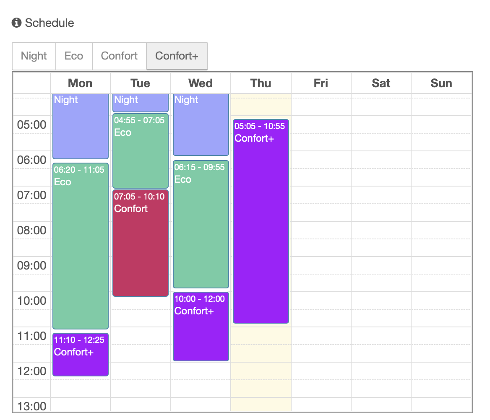
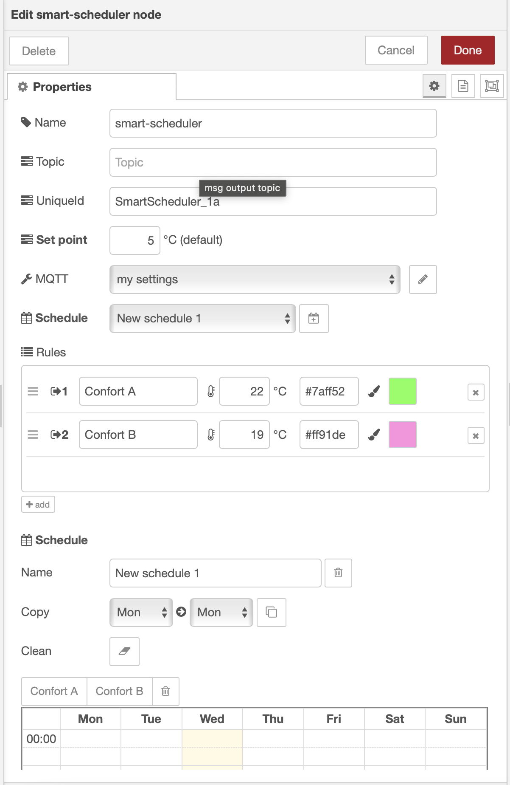
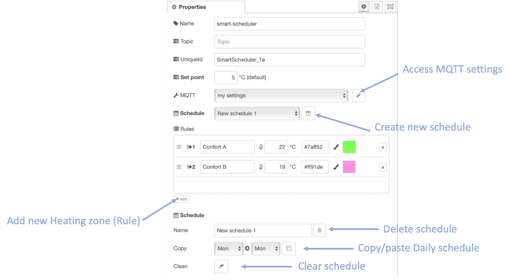
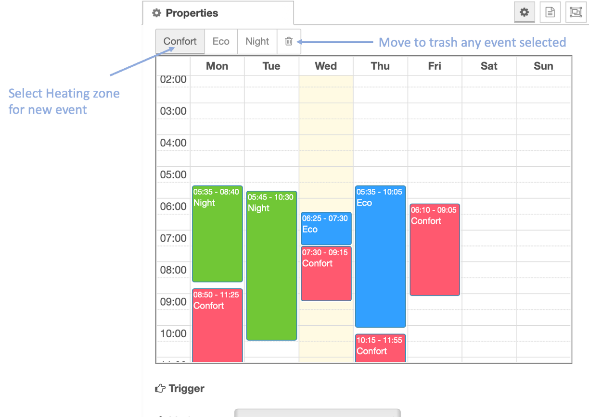
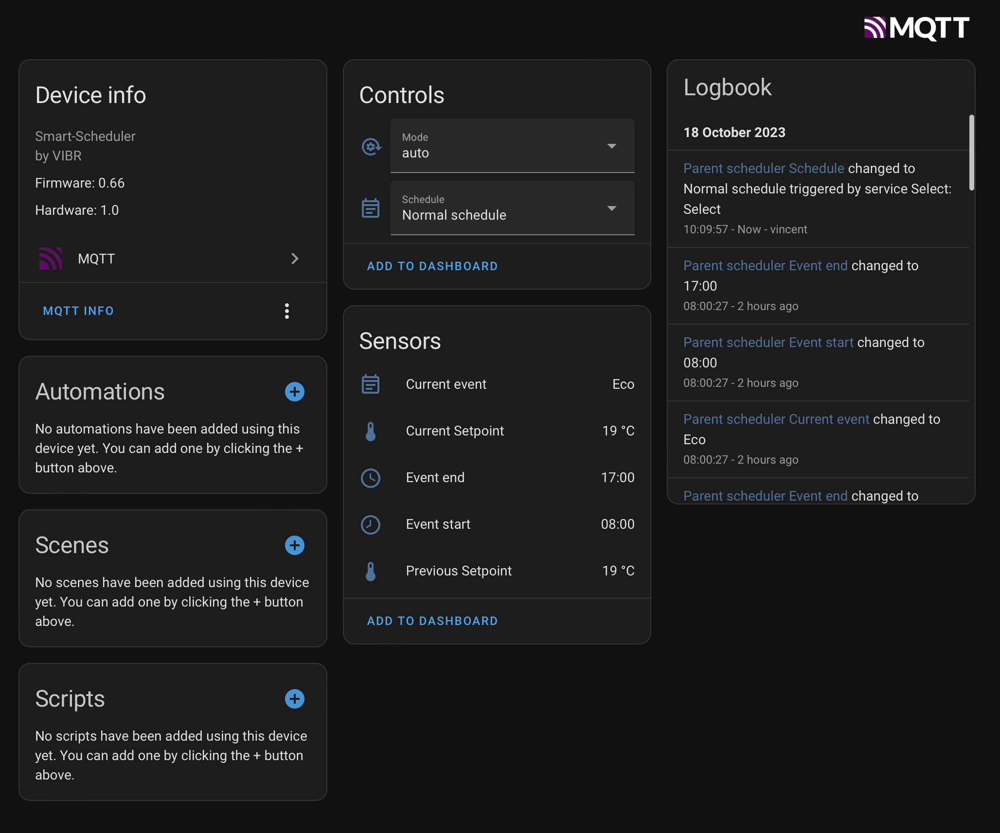

# Smart-Scheduler Node

The `smart-scheduler` node holds the weekly heating plan of a room (or group of rooms), edited on a calendar in the Node-RED editor, and sends the setpoint that applies now to the `smart-valve` nodes. Its mode and active schedule can be driven from Home Assistant over MQTT.



`smart-scheduler` holds the weekly heating plan of one room (or group of rooms) and sends the setpoint that
applies now to the `smart-valve` nodes wired to its output.

```
smart-scheduler ──set──▶ smart-valve(s) ──▶ smart-boiler
      ▲  │
      │  └── MQTT ──▶ Home Assistant (mode, schedule, current setpoint, current event…)
      └───── MQTT ◀── Home Assistant (change mode or schedule)
```

## Concepts

- **Set points** (rules): named temperatures with a colour, e.g. Cold 17 °C, Eco 19 °C, Confort 20 °C,
  Confort+ 21 °C.
- **Schedules**: weekly plans made of events painted on a calendar (Monday–Sunday). Each event uses one set
  point. A node can hold several schedules (Week, Holidays…); one is **active**.
- **Default set point**: applied when no event covers the current time.
- **Modes**: `auto` (follow the active schedule), `manual` (fixed setpoint for a limited time), `off`
  (default set point, see below).

## Node status

| Status | Meaning |
|---|---|
| 🟢 dot `Confort+ 21 °C Fri 18:00 - Fri 22:00` | Current event and its setpoint |
| ⚪ ring `Default sp: 5 °C` | No event now, default set point sent |
| 🟡 dot `Manual sp:22 °C, 47 min left` | Manual mode |
| ⚪ grey dot `Off, default sp: 5 °C` | Off |
| 🟡 dot `Not ready, schedule not defined` | No active schedule selected |

## Editor parameters



### General

| Field | What it does | Example |
|---|---|---|
| **Name** | Node name and Home Assistant device name. | `Parent scheduler` |
| **UniqueId** | Identifier used for the Home Assistant entities and MQTT topics. **Must be different for every scheduler**, otherwise their entities overwrite each other (the default `SmartScheduler_1` is a trap when you copy a node). | `Parent_sched` |
| **Set point (default)** | Setpoint sent when no event covers the current time, and in `off` mode. | `5` °C |
| **MQTT** | MQTT connection (`smart-scheduler-settings`). Optional: without it the node still works, without Home Assistant. | `jarvis` |

### Set points

One row per set point: **name**, **temperature** (0–35 °C; a non-numeric value now marks the node invalid,
0.81 accepted it and sent nothing usable), **colour** (type a hex code or click the brush to pick one).
**add** creates a new set point; the **×** deletes it together with every event that uses it, in all
schedules. Drag the ☰ handle to reorder.

### Schedules

| Control | What it does |
|---|---|
| **Active** | Schedule followed by the node. Switching it shows its events in the calendar. |
| 📅 (add) | Creates an empty schedule and selects it. |
| **Name** | Renames the active schedule. |
| 🗑 (delete) | Deletes the active schedule. |
| **Copy** day → day + ⧉ | Replaces the events of the destination day with a copy of the source day's events, keeping their length (an event crossing midnight stays crossing midnight). Sunday works since 0.82. |
| **Clean** (eraser) | Removes every event of the active schedule. |

### Calendar





- Click a set point button above the calendar (e.g. **Eco**), then **drag** in the calendar to paint a
  period. Times snap to 5 minutes.
- Drag an event to move it, drag its bottom edge to change its end.
- Click the 🗑 button above the calendar, then click an event to delete it.
- Events can cross midnight (e.g. Cold 22:00 → 06:00) and span several days.
- **Cancel** discards every change made in the dialog.
- The calendar works without internet: its libraries are now served by the module. If they cannot be loaded,
  a message is shown and the schedules are kept as they are when you click Done.

### Trigger

| Field | What it does | Default |
|---|---|---|
| **Mode** | When the setpoint is sent: *when state changes*, *when state changes + startup*, or *every minute*. | when state changes + startup |
| **Cycle** | How often the schedule is checked. | `1` min |
| **Re-send every** (new) | Re-sends the current setpoint this often even when it has not changed, so a valve that missed a message gets it again. `0` = only on change (0.81 behaviour). | `15` min |
| **Max setpoint** (new) | Ceiling for every setpoint sent: set points, default, manual and overrides. | `24` °C |

### Execution

| Field | What it does | Default |
|---|---|---|
| **Override** | Allows `override` commands (manual changes coming from a valve). In 0.81 this box had no effect; it is now enforced. | on in your flows |
| **Mode** | Initial mode at deploy: `auto`, `manual` or `off`. The mode chosen later in Home Assistant survives restarts; if you change this field (or the active schedule or the duration) and deploy, the editor value wins. | auto |
| **Duration** | Length of manual mode and of overrides. The schedule comes back automatically afterwards. | `120` min |
| **Set point** | Setpoint used when manual mode is chosen from Home Assistant. The editor proposes 0 °C for a new node: set a comfortable value (yours: 5 °C or 18 °C). | `0` °C (new node) |

**Off mode** now sends the default set point to the valves. In 0.81 it sent nothing, so the valves kept their
last setpoint and kept heating.

**Override loop guard**: an override with the same setpoint as the one that just expired, arriving within
10 minutes, is ignored. A person changing their mind still works; a stuck TRV repeating a stale value does not.

### Debug

| Field | What it does |
|---|---|
| **Debug Level** | None, Error, Warn, Info, Debug. At start-up (Info) the node logs the local time and UTC offset it uses: schedules follow the time zone of the Node-RED process, so run Node-RED with `TZ=Europe/Paris` (or your zone). |

## Messages

### Input

| `msg.payload.command` | Effect |
|---|---|
| `auto` | Follow the active schedule. |
| `off` / `0` | Off mode (default set point). |
| `on` / `1` / `trigger` | Re-send now (`on` also leaves off mode). |
| `override` + `setpoint` | Manual setpoint for *Duration* minutes (if Override is ticked), capped at Max setpoint. |
| `schedule` + `name` | Change the active schedule. |

### Output (to smart-valve)

```json
{ "command": "set", "setpoint": 21, "previous_setpoint": 20, "setname": "Confort+",
  "short_start": "18:00", "short_end": "22:00", "executionmode": "auto", "hasspchanged": true }
```

## Home Assistant



With an MQTT connection, each scheduler publishes a device with:

| Entity | Type | Use |
|---|---|---|
| Mode | select (`off`, `manual`, `auto`) | change the mode from Home Assistant |
| Schedule | select (schedule names) | switch Week / Holidays… |
| Current Setpoint / Previous Setpoint | sensors (°C) | |
| Duration left | sensor (min) | remaining manual time |
| Current event, Event start, Event end | sensors | |

Topics: `<root path>/<UniqueId>/<entity>/state` and `/set`. Since 0.82 the **Root path** of the settings
node is actually used (0.81 always used `homeassistant`).

## Settings node (`smart-scheduler-settings`)

| Field | What it does |
|---|---|
| **Name** | Label. |
| **MQTT Host / Port / Username / Password** | Broker connection. |
| **Root path** | Home Assistant discovery prefix (`homeassistant`). |
| **Test Connection** | Checks the broker. |

## Tests

```
npm install
npm test
```

23 tests cover schedule matching and the node; `test/ui` holds 19 browser tests for the editor (see its README).

## Changes

See [CHANGELOG.md](CHANGELOG.md).

---
*Author: Vincent BESSON*
*License: Creative Commons*

<a href="https://www.buymeacoffee.com/vincentbe" target="_blank"></a>
